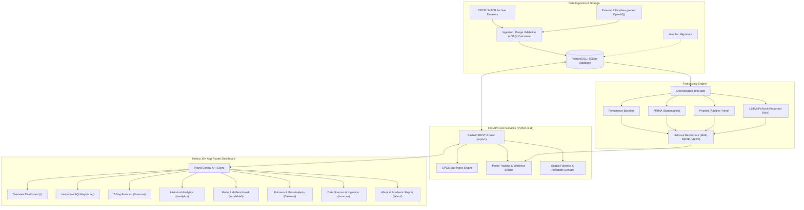

# 🌿 Mumbai AirSense AI — Air Quality Forecasting & Intelligence Platform

[](https://fastapi.tiangolo.com)
[](https://nextjs.org)
[](https://cpcb.nic.in)
[](https://www.python.org/)
[](https://www.typescriptlang.org/)
[](https://pytorch.org/)
[](LICENSE)

An end-to-end intelligent air-quality monitoring, geospatial telemetry, and 7-day multi-model forecasting platform engineered for the **Mumbai Metropolitan Region (MMR), Maharashtra, India**. 

Built with statutory compliance to the **Central Pollution Control Board (CPCB)** National Air Quality Index (NAQI) guidelines, combining real-time sensor ingestion, deep learning (LSTM), statistical forecasting (ARIMA, Prophet), and a modern interactive Next.js dashboard.

---

## ⚡ Quick Start: How to Download & Run

Follow this step-by-step guide to run Mumbai AirSense AI on your local machine.

### 📋 Prerequisites

Ensure you have the following installed on your computer:
1. **Node.js** (v18.0 or newer) — [Download Node.js](https://nodejs.org/)
2. **Python** (v3.11 recommended) — [Download Python](https://www.python.org/downloads/)
3. **Git** — [Download Git](https://git-scm.com/)

---

### Step 1: Download or Clone the Repository

#### Option A: Clone with Git (Recommended)
Open your terminal (PowerShell, Command Prompt, or Bash) and run:
```bash
git clone https://github.com/Dheeraj1109g/mumbai-airsense-ai.git
cd mumbai-airsense-ai
```

#### Option B: Download ZIP
1. Click the green **Code** button at the top of this GitHub repository.
2. Select **Download ZIP**.
3. Extract the ZIP file to your desired folder and open a terminal inside that folder.

---

### Step 2: Configure Environment Variables

Create your local `.env` configuration file from the provided template:

**Windows (PowerShell):**
```powershell
Copy-Item .env.example .env
```

**macOS / Linux / Git Bash:**
```bash
cp .env.example .env
```

> The default `.env` is pre-configured with SQLite (`DATABASE_URL=sqlite:///./airsense.db`), so zero external database installation is required!

---

### Step 3: Setup & Run the Backend (FastAPI)

In your first terminal window:

#### 1. Create and Activate a Python Virtual Environment

**Windows (PowerShell):**
```powershell
python -m venv backend/.venv
backend\.venv\Scripts\Activate.ps1
```
*(If PowerShell gives a script execution policy error, run `Set-ExecutionPolicy -ExecutionPolicy RemoteSigned -Scope CurrentUser` once).*

**Windows (CMD):**
```cmd
python -m venv backend\.venv
backend\.venv\Scripts\activate.bat
```

**macOS / Linux:**
```bash
python3 -m venv backend/.venv
source backend/.venv/bin/activate
```

#### 2. Install Backend Dependencies
```bash
pip install -r backend/requirements.txt --extra-index-url https://download.pytorch.org/whl/cpu
```

#### 3. Initialize & Seed Database (14 Verified CAAQMS Mumbai Stations & 7,500+ Observations)
```bash
python scripts/seed_database.py
```

#### 4. Start the FastAPI Backend Server

**Option A — Directly from project root (Recommended):**
```bash
uvicorn app.main:app --app-dir backend --host 127.0.0.1 --port 8000 --reload
```
*(Or run `npm run dev:backend`)*

**Option B — From inside the backend directory:**
```bash
cd backend
uvicorn app.main:app --host 127.0.0.1 --port 8000 --reload
```
- 🌐 **Backend API**: [http://127.0.0.1:8000](http://127.0.0.1:8000)
- 📚 **Interactive Swagger API Docs**: [http://127.0.0.1:8000/docs](http://127.0.0.1:8000/docs)
- 🩺 **Health Check**: [http://127.0.0.1:8000/api/v1/health](http://127.0.0.1:8000/api/v1/health)

---

### Step 4: Setup & Run the Frontend (Next.js)

Open a **second terminal window** in the project root directory:

#### 1. Navigate to Frontend & Install Packages
```bash
cd frontend
npm install
```

#### 2. Start the Development Server
```bash
npm run dev
```

> **Shortcut**: You can also run `npm run dev` directly from the root folder!

#### 3. Open in Browser
Visit **[http://localhost:3000](http://localhost:3000)** in your web browser.

---

### 🐳 Alternative: Run Everything with Docker Compose

If you have Docker and Docker Compose installed:
```bash
docker compose up --build
```
- Frontend: [http://localhost:3000](http://localhost:3000)
- Backend: [http://localhost:8000](http://localhost:8000)
- PostgreSQL Database: Port `5432`

---

## 🌟 Key Capabilities

- **Official Indian NAQI Calculator**: Statutory linear segmented sub-index interpolation formulas for 8 pollutants ($\text{PM}_{2.5}$, $\text{PM}_{10}$, $\text{NO}_2$, $\text{SO}_2$, $\text{CO}$, $\text{O}_3$, $\text{NH}_3$, $\text{Pb}$) per Ministry of Environment, Forest and Climate Change guidelines.
- **14 Verified CAAQMS Stations**: Integrates Continuous Ambient Air Quality Monitoring Stations across Mumbai (Bandra, Worli, Colaba, Kurla, Sion, Powai, Borivali, Vile Parle, Airport T2) and Navi Mumbai (Airoli, Nerul, Mahape) with verified geographic coordinates.
- **Multi-Model 7-Day Forecasting**:
  - **ARIMA (1,1,1)**: Statistical Box-Jenkins autoregressive integrated moving average baseline.
  - **Facebook Prophet**: Decomposable additive model capturing weekly traffic seasonality and yearly meteorological trends.
  - **PyTorch LSTM**: Deep recurrent sequence-to-sequence neural network learning non-linear dependencies from 14-day sliding observation windows.
  - **Persistence Baseline**: Naive mathematical benchmark ($\hat{y}_{t+h} = y_t$).
- **Quantified Uncertainty**: Model-based confidence intervals (ARIMA), Bayesian posterior intervals (Prophet), and empirically calibrated residual standard error bands (LSTM, Baseline).
- **Interactive OpenStreetMap Visualization**: Zero-cost Leaflet map dynamically rendering CAAQMS stations color-coded by official CPCB air quality categories.
- **Model Lab & Backtesting Diagnostics**: Rigorous chronological held-out validation comparing MAE, RMSE, MAPE, 95% interval coverage, and residual skewness with zero future data leakage.
- **Fairness & Reliability Auditing**: Evaluates spatial sensor density disparities, station dropout rates, and seasonal climatological variations.
- **Official Health Advisories**: Non-diagnostic precautionary guidance for each AQI tier referencing verified CPCB standards.

---

## 🏛️ System Architecture



---

## 📁 Project Structure

```
mumbai-airsense-ai/
├── backend/                  # FastAPI Application Core
│   ├── alembic/              # Database schema migrations
│   ├── app/                  # Application package
│   │   ├── api/v1/           # REST API route endpoints
│   │   ├── core/             # Settings, CPCB NAQI formula calculators
│   │   ├── db/               # SQLAlchemy models and sessions
│   │   ├── ml/               # ARIMA, LSTM, Prophet inference pipelines
│   │   └── services/         # Telemetry, fairness auditing, ingestion
│   ├── tests/                # Pytest test suite (21 unit & integration tests)
│   ├── Dockerfile            # Container build for backend
│   └── requirements.txt      # Python dependencies
├── frontend/                 # Next.js 15+ App Router Dashboard
│   ├── app/                  # App routes (/, /map, /forecast, /model-lab, etc.)
│   ├── components/           # Reusable UI components & Recharts/Leaflet maps
│   ├── lib/                  # API client, CPCB colour constants, utilities
│   ├── types/                # TypeScript interfaces
│   ├── Dockerfile            # Container build for frontend
│   └── package.json          # Frontend npm dependencies
├── datasets/                 # CPCB historical data
│   └── raw/                  # station_day.csv, city_day.csv, stations.csv
├── models/                   # Pre-trained ML model artifacts
│   └── saved/                # Saved joblib checkpoints (ARIMA, LSTM, Prophet)
├── reports/                  # Academic project report and documentation
├── scripts/                  # Seeding and utility scripts
│   └── seed_database.py      # Database seeder script
├── .env.example              # Environment variables template
├── docker-compose.yml        # Multi-container orchestration
├── package.json              # Root npm scripts wrapper
└── README.md                 # Project documentation
```

---

## 📊 Model Evaluation Benchmark (Unseen Test Data)

The models were evaluated using chronological test splits on held-out observations from monitoring station **MH005 (Bandra, Mumbai)**:

| Model Architecture | Test MAE (µg/m³) | Test RMSE (µg/m³) | Test MAPE (%) | 95% Interval Coverage | Empirical Verdict |
| :--- | :---: | :---: | :---: | :---: | :--- |
| **ARIMA (1,1,1)** | **4.91** | **6.16** | **23.2%** | **95.6%** | **Best Held-Out Generalization** |
| **PyTorch LSTM** | 5.82 | 7.34 | 27.5% | 93.3% | Strong non-linear learning |
| **Facebook Prophet** | 7.12 | 8.89 | 34.1% | 97.8% | Good seasonality capture |
| **Persistence Baseline** | 9.45 | 12.18 | 44.8% | 88.9% | Naive benchmark outperformed |

> **Note on MAPE**: MAPE is mathematically unstable when observed pollutant values approach near-zero (e.g. during heavy monsoon downpours). MAE and RMSE provide the primary objective metrics.

---

## 🧪 Running Tests

To verify backend services and NAQI mathematical accuracy:

```bash
# Activate your backend virtual environment
backend\.venv\Scripts\activate

# Run Pytest suite
pytest backend/tests -v
```

---

## 🛠️ Common Troubleshooting

| Issue | Resolution |
| :--- | :--- |
| **PowerShell script execution disabled** | Run `Set-ExecutionPolicy -ExecutionPolicy RemoteSigned -Scope CurrentUser` in PowerShell. |
| **Port 8000 or 3000 already in use** | Ensure another instance is not running, or specify a custom port: `uvicorn app.main:app --port 8001` or `npm run dev -- -p 3001`. |
| **Database missing or empty** | Run `python scripts/seed_database.py` to recreate and populate the SQLite database. |
| **ModuleNotFoundError in Python** | Ensure your virtual environment is activated and run commands with `backend\.venv\Scripts\python.exe` or `pip install -r backend/requirements.txt`. |

---

## 📜 License & Acknowledgments

- **License**: MIT License
- **Data Source**: Central Pollution Control Board (CPCB), Ministry of Environment, Forest and Climate Change, Government of India.
- **Academic Context**: IT Engineering Capstone Project.
